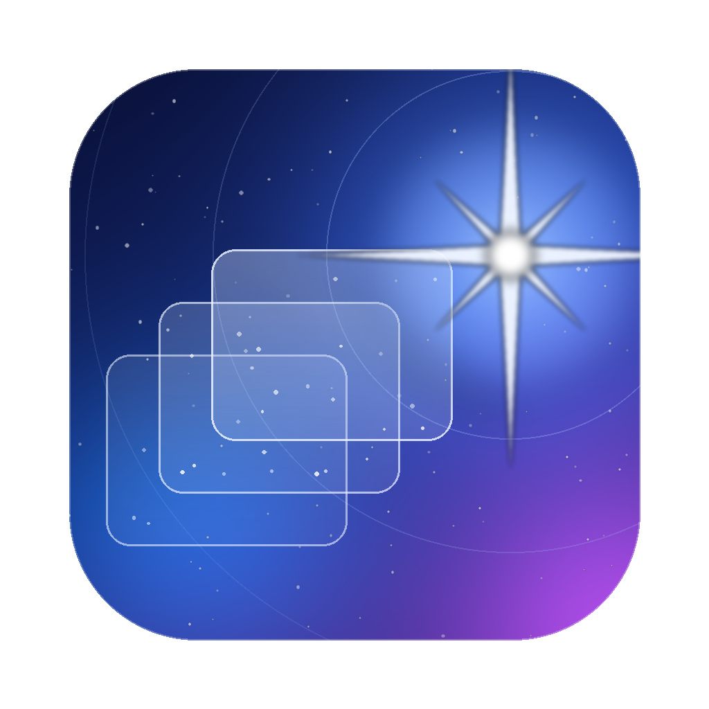
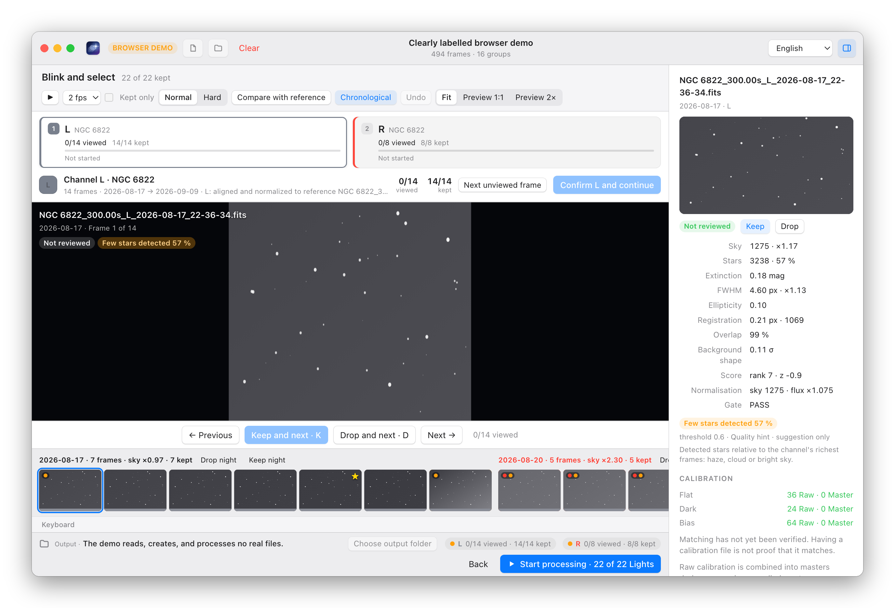
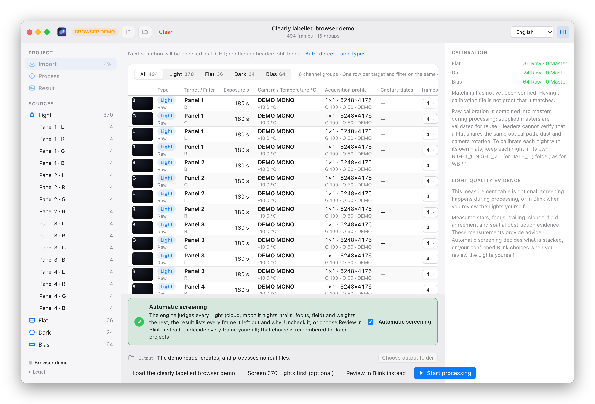
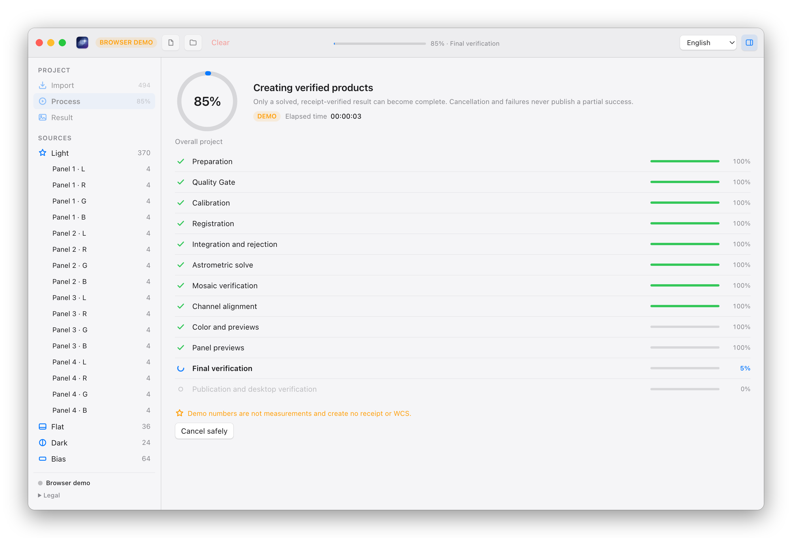
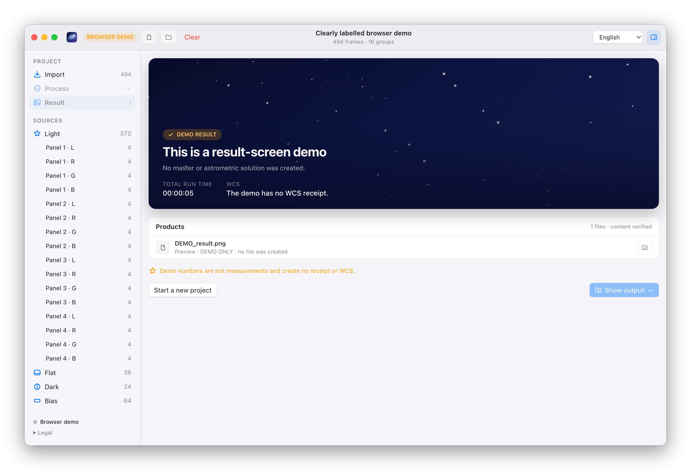
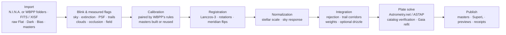

<p align="center">
  
</p>

<h1 align="center">Ultra-Fast WBPP</h1>

<p align="center"><b>Nights of astrophotography in. Verified, plate-solved masters out. In about a minute, not an evening.</b></p>

<p align="center">
  <a href="https://github.com/ShuoleiWang/Ultra-Fast-WBPP/actions/workflows/ci.yml"></a>
  
  
  
  <a href="LICENSE"></a>
</p>

<p align="center">
  <a href="docs/README.zh-CN.md">简体中文</a> ·
  <a href="#why-ultra-fast-wbpp">Why</a> ·
  <a href="#what-it-looks-like">Screenshots</a> ·
  <a href="#download">Download</a> ·
  <a href="#quick-start">Quick start</a> ·
  <a href="docs/getting-started.md">Getting started</a> ·
  <a href="docs/README.md">Docs</a> ·
  <a href="CONTRIBUTING.md">Contributing</a>
</p>

<picture>
  <source media="(prefers-color-scheme: dark)" srcset="assets/branding/ultra-fast-wbpp-blink-dark.png">
  
</picture>

<p align="center"><i>Blink: every Light of a channel, aligned and stretched alike, with its measurements beside it. Light and dark follow the system. (Browser demo with labelled interface values; the native app shows your real frames and masters.)</i></p>

## Why Ultra-Fast WBPP

- **An evening of WBPP becomes about a minute.** 61 Lights (26 MP, four nights, L R G B) took PixInsight WBPP 3.0.1 **24 min 11 s** on an M3 Pro. Ultra-Fast WBPP turned the same Lights into solved, verified masters on the same Mac in **76 s** ([features §1](docs/features.md#1-speed-76-seconds-for-61--26-mp-lights)).
- **Every frame is judged with reasons you can read.** Sky brightness, extinction, star counts, native-resolution PSF, trailing, clouds, occlusion and field agreement are measured on every Light. You see the numbers in Blink and decide; the run then applies exactly your decisions ([Blink screening](docs/recipes/blink-screening.md)).
- **The sky coordinates are verified, not assumed.** Every master is plate-solved and checked against catalog stars before it is published. With the Gaia tiles installed, the WCS is refitted on catalog stars to about 0.15″ on real data ([astrometry](docs/recipes/astrometry.md)).
- **Free and open.** MIT licensed, runs on macOS Apple Silicon and Windows x64, needs no PixInsight. Your Lights are never written to, results go into a new folder, and nothing is uploaded anywhere.

### Compared with PixInsight WBPP

| | Ultra-Fast WBPP | PixInsight WBPP |
|---|---|---|
| 61 × 26 MP Lights, four nights, L R G B, M3 Pro | **76 s** | 24 min 11 s (WBPP 3.0.1, its default route with LocalNormalization) |
| Frame selection | measured evidence per Light, reviewed by you in Blink; the headless unattended policy adds a leave-one-out check inside the integration and region weight maps for partial cloud | whole-frame weights and threshold rejection |
| Calibration pairing | WBPP's rules, night by night (`NIGHT_…`, `DATE_…` folders); a folder prepared for WBPP imports as it is | WBPP's rules |
| Plate solving | every master solved and verified on catalog stars; refitted to TAN-SIP up to order 3 on Gaia stars when the tiles are installed | astrometric solution in the default route |
| Mosaics | several panels placed by one astrometric fit of all panels on one shared canvas, matched by overlap stars; a real six-panel M31 (713 Lights) publishes | not part of WBPP |
| Trust | read-only sources, create-only results, receipts with hashes and algorithm ids, verified WCS before "done", bit-identical reruns of mono masters | console log |
| Master quality | historical G₈ 1.01–1.03 against the WBPP masters of the same data; full equivalence not certified | the reference |
| Drizzle | native 1×–4× from exactly the integration's inputs, Bayer drizzle | DrizzleIntegration |
| Platforms, license | macOS Apple Silicon, Windows x64 · MIT, no PixInsight needed | macOS, Windows, Linux · commercial |
| After preprocessing | linear masters, `SuperL.fits`, previews, receipts; no post-processing | a complete platform |

The WBPP time is one measurement of its default route on identical inputs; the two tools' stage lists are not identical, and the reference Lights are no longer available for a re-measurement. Later builds measured the same project at 64–67 s, and at 79 s with the Gaia catalog refit, one run each ([CHANGELOG](CHANGELOG.md)). The complete comparison with the evidence behind every row, and the list of what this project does *not* do, is [docs/features.md](docs/features.md).

## Who it is for

- You shoot mono or one-shot-colour deep sky with N.I.N.A. or a similar sequencer, over several nights, and want calibrated, stacked, plate-solved linear masters without babysitting a script for an evening.
- You own PixInsight and want to keep it for post-processing: the masters open there as ordinary linear FITS with a verified WCS.
- You do not own PixInsight and want a free preprocessing path whose results are measured against WBPP's rather than described.
- You want to see *why* a frame was kept or dropped, and to decide yourself.

It is preprocessing only: no stretching, gradient removal, deconvolution or colour calibration.

## What it looks like

| 1 · Import | 2 · Blink |
|---|---|
| <picture><source media="(prefers-color-scheme: dark)" srcset="assets/branding/ultra-fast-wbpp-frames-dark.png"></picture> | <picture><source media="(prefers-color-scheme: dark)" srcset="assets/branding/ultra-fast-wbpp-blink-dark.png"></picture> |
| **3 · Processing** | **4 · Result** |
| <picture><source media="(prefers-color-scheme: dark)" srcset="assets/branding/ultra-fast-wbpp-run-dark.png"></picture> | <picture><source media="(prefers-color-scheme: dark)" srcset="assets/branding/ultra-fast-wbpp-result-dark.png"></picture> |

1. **Import.** Drop all your nights at once: Lights, raw Flat/Dark/Bias or existing masters, N.I.N.A. folder layouts, or a folder you prepared for PixInsight WBPP. Types, targets and filters come from the headers; calibration is paired by WBPP's rules, night by night ([calibration](docs/recipes/calibration.md)).
2. **Blink.** Each channel gets a reference frame and one shared stretch. Step or play through the Lights, compare with the reference, keep or drop a frame or a whole night, undo. The flags are measured hints; the decisions are yours, and each channel is confirmed explicitly.
3. **Processing.** **Start processing** becomes available once every Light has been reviewed, every channel confirmed, an output folder chosen and the solver is ready. Calibration, registration, normalization, integration, optional drizzle and the per-channel plate solve run as one job with live progress.
4. **Result.** One linear FITS per filter, `RGB.fits` or `LRGB.fits` when R, G and B exist, `SuperL.fits` (a super luminance of the broadband channels, on by default), `previews/`, `receipt.json` and `details/`. The app shows *done* only after the receipt, the product hashes and the final WCS have been verified.

Screenshots are rendered from the app's labelled browser demo by [`apps/desktop/scripts/screenshots.py`](apps/desktop/scripts/screenshots.py); the numbers in them are interface placeholders, not measurements. The step-by-step guide with an FAQ is [docs/getting-started.md](docs/getting-started.md).

## Download

Releases will appear on the [Releases page](https://github.com/ShuoleiWang/Ultra-Fast-WBPP/releases) with checksums and bundle attestations. Today the way in is building from source ([guide](docs/building-from-source.md)): one command chain on a Mac,

```bash
make bootstrap BOOTSTRAP_PYTHON=python3.12
make desktop-dev                                     # runs the app from the clone
# or, for a local app bundle:
CARGO_PROFILE_RELEASE_STRIP=none make desktop-build-macos-prerelease
```

Windows builds are described in [docs/windows.md](docs/windows.md).

- **macOS.** The app is ad-hoc signed and not notarized. On macOS 15 and later the right-click → Open bypass no longer works: open System Settings → Privacy & Security → **Open Anyway**, or run `xattr -dr com.apple.quarantine "Ultra-Fast WBPP.app"`.
- **Windows.** The installer is unsigned; SmartScreen shows "Windows protected your PC" → More info → **Run anyway**.

### Set up a plate solver

Nothing is bundled, for licensing reasons ([licensing](docs/licensing.md)), so each computer needs a solver:

1. **Install the solver.** macOS: `brew install astrometry-net` (gives `solve-field`). Windows: [ASTAP](https://www.hnsky.org/astap.htm) (`astap_cli.exe`) with a star database such as D20 or D50 unpacked into the ASTAP folder ([Windows](docs/windows.md)).
2. **Download the index set in the app.** Under *Advanced options and solver setup*, accept the provider terms and download the managed Astrometry.net index set (about 350 MB), then press **Recheck setup**.
3. **Optional, for the catalog refit.** The distortion-corrected WCS (about 0.15″ on real data) needs the Gaia DR2 LITE tiles (587 MiB), which the app cannot download yet. From a terminal: `ultra-fast-wbpp catalog install astrometry-net-5205-lite --accept-provider-terms <id from catalog list> --progress-json` ([offline solver catalogs](docs/recipes/offline-solver-catalogs.md)). In a built macOS app the engine is `Ultra-Fast WBPP.app/Contents/Resources/resources/ufwbpp-engine/ufwbpp-engine-aarch64-apple-darwin/ufwbpp-engine-aarch64-apple-darwin`.

Moving to another computer: copy the catalog folder (`<data root>/catalogs/astrometry-net`) to the same data root there and open the app; the engine re-points its config and receipts to the new place, while the solver program itself must be installed on each computer ([moving the catalog](docs/recipes/offline-solver-catalogs.md)).

## Quick start

Import your folders, review every channel in Blink, choose an output folder (remembered next time) and press **Start processing**. To try the interface without data, `make demo` opens the labelled browser demo. The language defaults to English; the selector is in the toolbar and the choice is remembered. The first-run guide: [docs/getting-started.md](docs/getting-started.md).

The same engine runs from the command line:

```bash
.venv/bin/ultra-fast-wbpp run /data/lights /data/calibration --recipe docs/recipes/mono-standard.json --output /data/new-result --progress-json
```

`ultra-fast-wbpp doctor --json` reports the hardware, the native kernels and the solver readiness; `run-project` is the multi-target, multi-filter route the desktop uses. The headless default selection is `legacy-gate`; `{ "selection": { "policy": "unattended-v1" } }` in the recipe enables the unattended policy with the leave-one-out check and region weights ([automatic screening](docs/recipes/automatic-screening.md)).

## Status and requirements

- **Alpha, under active development.** Real-data runs are validated on one M3 Pro (macOS) and one Ryzen 7 5800H laptop (Windows 11); other machines run generic, unmeasured profiles. The register of what is and is not validated is [docs/validation-matrix.md](docs/validation-matrix.md).
- **Mono is validated on real data.** One-shot colour (Bayer) Lights are calibrated as mosaics, debayered into R/G/B channel masters and combined into RGB ([recipe](docs/recipes/osc-cfa.md)), but only on synthetic data so far. Mosaics are validated on real M31 mosaics (2×2, five and six panels) ([recipe](docs/recipes/project-mosaic-rgb.md)); drizzle onto the mosaic canvas has synthetic pipeline tests only.
- **Bit-identical reruns** hold for mono masters. RGB pixels are identical between reruns while the file's checksum cards differ.
- **Blink review is mandatory in the desktop.** The flags were developed on one six-night campaign and cannot guarantee detection of every defect; your decisions control admission.
- **Plate solving needs a solver on each computer** (above). Nothing is uploaded anywhere.
- **Disk space** for full-resolution intermediate frames: about 12 bytes per pixel per Light on the output volume.
- **Inputs:** FITS and XISF Lights, raw calibration frames or masters (including PixInsight WBPP's XISF masters). Not supported: DSLR RAW files, and Lights that WBPP already calibrated or registered (they are refused; import the raw Lights).

## Recent capabilities

Each item links to its [CHANGELOG](CHANGELOG.md) section.

- [Mosaics on one shared canvas](CHANGELOG.md#mosaics-on-one-canvas), [placed by one fit of all panels](CHANGELOG.md#mosaic-panels-are-placed-by-one-fit-of-all-panels), and [drizzled onto that canvas](CHANGELOG.md#mosaic-panels-drizzle-onto-their-shared-canvas). A real six-panel M31 mosaic of 713 Lights publishes ([validation matrix](docs/validation-matrix.md)).
- [A catalog-refitted WCS](CHANGELOG.md#published-masters-can-carry-a-catalog-refitted-wcs): TAN-SIP up to order 3 on Gaia stars, about 0.15″ on held-out stars on real masters, with the [Gaia DR2 tiles](CHANGELOG.md#gaia-dr2-index-tiles-for-the-catalog-refit) and a [verification robust to old Tycho-2 positions](CHANGELOG.md#a-catalog-refits-verification-no-longer-turns-on-a-few-stars-the-catalog-misplaces).
- [A filter whose own solve misses the gate takes its grid's solve](CHANGELOG.md#a-filter-whose-own-solve-misses-a-gate-takes-its-grids-solve-verified-by-the-catalog-refit), verified by the refit; [a run whose solves all miss only the RMS gate still reaches the refit](CHANGELOG.md#a-run-whose-solves-all-miss-the-rms-gate-can-still-reach-the-catalog-refit).
- [Projects with narrowband or partial filter sets publish](CHANGELOG.md#a-project-of-several-filters-without-full-rgb-publishes-its-masters).
- Screening [keeps uniform thin cloud](CHANGELOG.md#screening-judges-extinction-on-every-night-and-keeps-uniform-thin-cloud) and [a night whose optics elongate every star](CHANGELOG.md#screening-keeps-a-night-whose-optics-elongate-every-star), and [fails a Light taken off the field](CHANGELOG.md#screening-fails-a-light-taken-off-its-groups-field).
- [Importing folders arranged for PixInsight WBPP](CHANGELOG.md#importing-files-arranged-by-pixinsight-wbpp) and [calibration paired by WBPP's rules](CHANGELOG.md#calibration-paired-by-wbpps-rules).
- [`SuperL.fits`](CHANGELOG.md#a-super-luminance-beside-the-channels): the broadband channels combined into one deeper luminance, each weighted by its noise; a channel with clearly worse stars is left out. The masters are unchanged.

## Numbers

| What | Result | Where |
|---|---|---|
| 61 Lights · 4 nights · L R G B · M3 Pro | **76 s** end to end (170 → 97 → 82 → 76 s from three changes within days) | [features §1](docs/features.md#1-speed-76-seconds-for-61--26-mp-lights), [CHANGELOG](CHANGELOG.md) |
| PixInsight WBPP 3.0.1, same Lights, same Mac | 24 min 11 s | [features §1](docs/features.md#1-speed-76-seconds-for-61--26-mp-lights) |
| Same project on a Ryzen 7 5800H laptop, Windows 11 | 267–289 s | [Windows](docs/windows.md) |
| Two runs of one project on one machine | mono masters bit-identical; RGB pixels identical, checksum cards differ | [validation matrix](docs/validation-matrix.md) |
| Masters vs PixInsight WBPP (same frames) | historical G₈ 1.01–1.03; full equivalence not certified | [features §5](docs/features.md#5-master-quality-against-pixinsight-wbpp), [evaluation standard](docs/master-evaluation-standard.md) |
| 2× drizzle vs the Lanczos-3 master | half-light radius 2.5–4.4 % smaller, effective noise 6–7 % lower, flux ratio 0.993–0.994 | [drizzle recipe](docs/recipes/drizzle.md) |
| Catalog refit of a real master | 0.157″ on held-out Gaia stars (NGC 7331), against the solver's 2.58″ on the same stars | [astrometry](docs/recipes/astrometry.md), [CHANGELOG](CHANGELOG.md#gaia-dr2-index-tiles-for-the-catalog-refit) |

This independent implementation does not claim algorithmic or pixel equivalence to PixInsight/WBPP; the [evaluation standard](docs/master-evaluation-standard.md) is how it is compared.

## How it works



The hot loops are multithreaded native kernels that reproduce the NumPy reference value for value; a Light is decoded once, calibrated in memory and warped straight into the stack. The execution path, boundaries and science are in [docs/architecture.md](docs/architecture.md); the user guides are the [recipes](docs/recipes/README.md).

## Repository

| Directory | Responsibility |
|---|---|
| `apps/desktop` | React interface and Tauri desktop bridge; it runs the engine's command line ([guide](apps/desktop/README.md)) |
| `packages/engine` | The `ultra-fast-wbpp` engine (Python package `ufwbpp`): workflows, stacking, selection, solvers, products, CLI |
| `packages/light-frame-qc`, `packages/registration` | Light measurements, native PSF, quality gate, Blink flags; star detection, transform estimation, warping |
| `native` | C++ kernels (warp, rejection, reduction, drizzle, debayer, Lanczos table) and Metal |
| `tools/validation`, `benchmarks` | Master evaluation and tolerance gate; run tracer, kernel benchmarks (dated evidence in `docs/evidence`) |
| `scripts`, `packaging` | Native build chain, engine sidecar packaging, bundle attestation, public-tree and link checks |
| `docs` | [Index](docs/README.md) · [getting started](docs/getting-started.md) · [features](docs/features.md) · [architecture](docs/architecture.md) · [recipes](docs/recipes/README.md) · [validation](docs/validation-matrix.md) |

Contributing: [CONTRIBUTING.md](CONTRIBUTING.md) for setup and rules, [AGENTS.md](AGENTS.md) for the full working guide. `make test` runs the Python, Rust, frontend and native tests; `make check` adds formatting, lint and the public-tree checks.

## License

Original code is [MIT licensed](LICENSE); keep the copyright and license notice when redistributing, including commercially ([NOTICE](NOTICE) suggests an attribution). Third-party components keep their own licenses ([licensing](docs/licensing.md), [third-party notices](THIRD_PARTY_NOTICES.md)); the Python runtime imports no GPL-licensed library.

Not affiliated with PixInsight, Pleiades Astrophoto, N.I.N.A., Astrometry.net or ASTAP; contains no PixInsight/PCL source or binaries.
