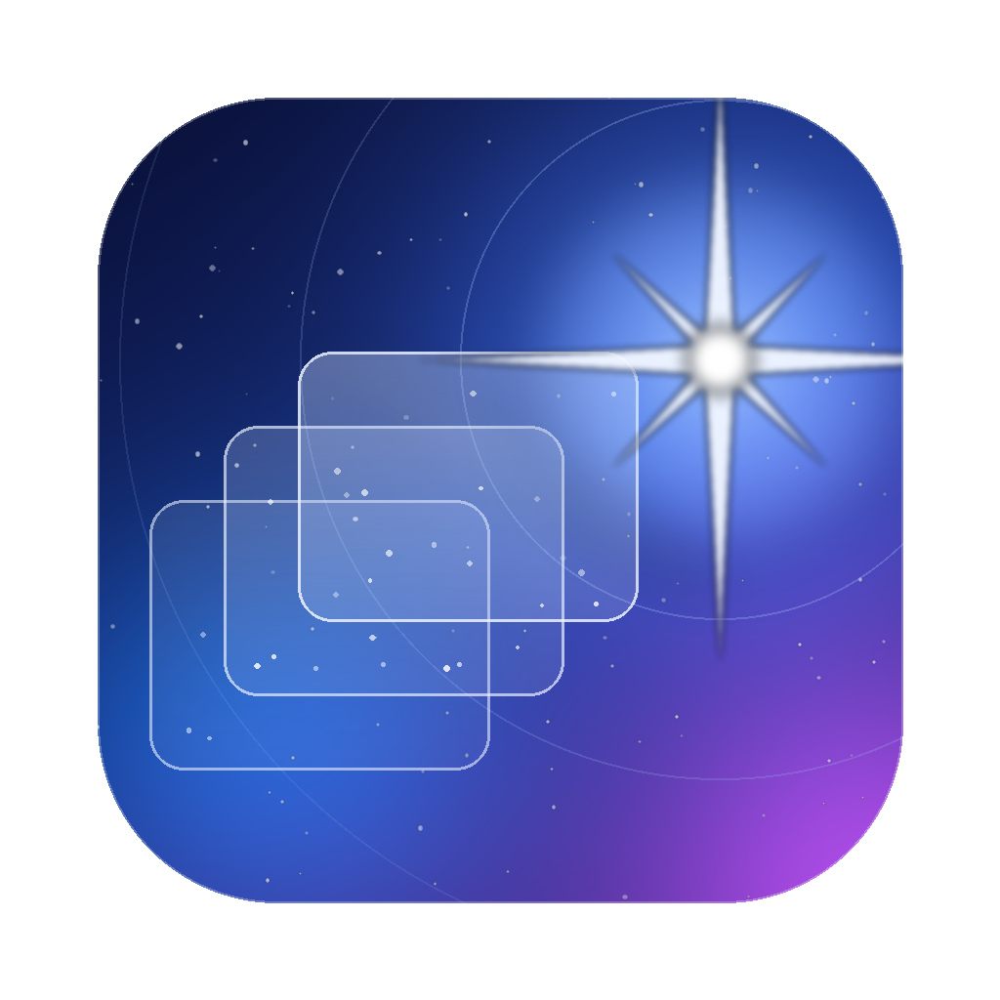
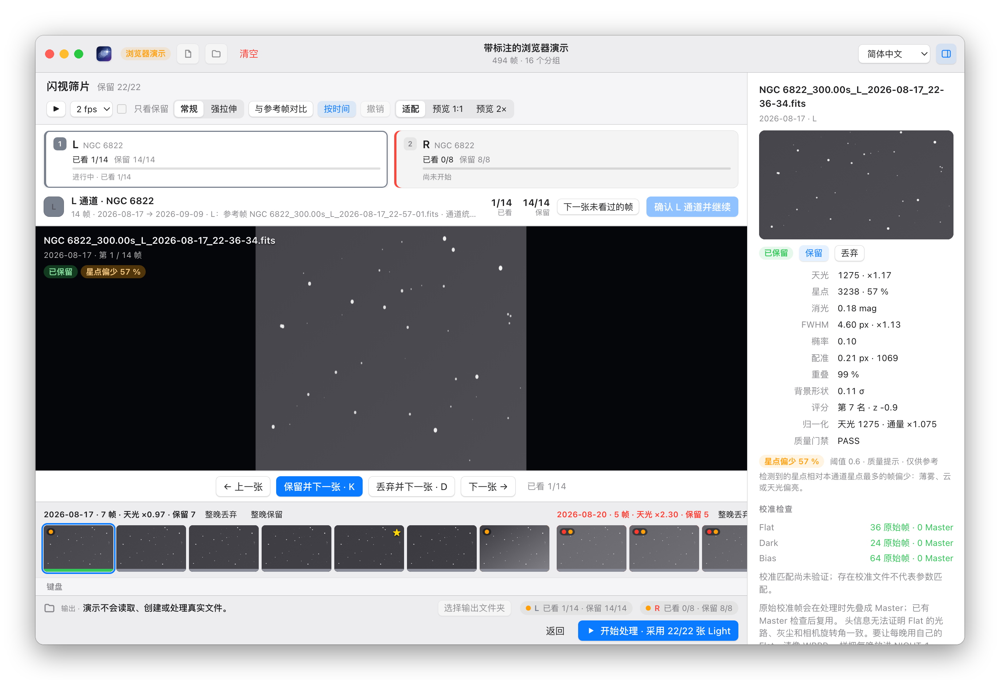
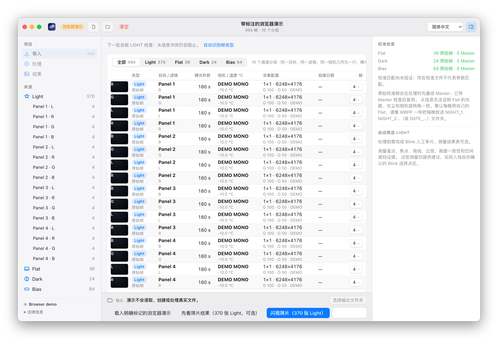
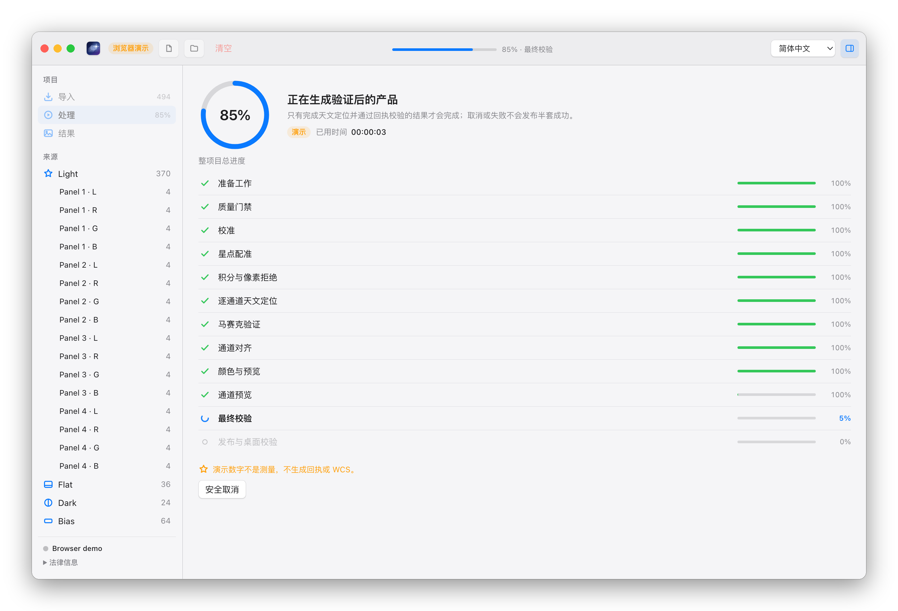
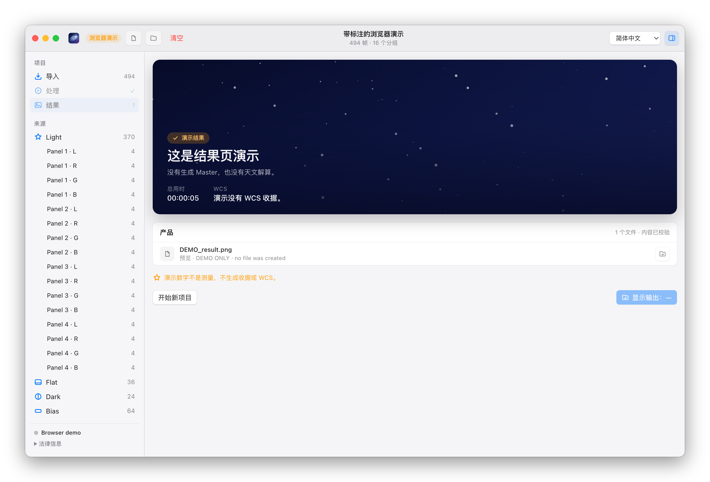
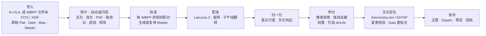

<p align="center">
  
</p>

<h1 align="center">Ultra-Fast WBPP</h1>

<p align="center"><b>几晚的深空素材拖进来，经过校验、带天文坐标的主图出来。一分钟左右，不用等一整晚。</b></p>

<p align="center">
  <a href="https://github.com/ShuoleiWang/Ultra-Fast-WBPP/actions/workflows/ci.yml"></a>
  
  
  
  <a href="../LICENSE"></a>
</p>

<p align="center">
  <a href="../README.md">English</a> ·
  <a href="#为什么用-ultra-fast-wbpp">为什么</a> ·
  <a href="#界面">界面</a> ·
  <a href="#下载">下载</a> ·
  <a href="#快速开始">快速开始</a> ·
  <a href="getting-started.zh-CN.md">上手指南</a> ·
  <a href="README.md">文档索引</a> ·
  <a href="../CONTRIBUTING.md">参与贡献</a>
</p>

<picture>
  <source media="(prefers-color-scheme: dark)" srcset="../assets/branding/ultra-fast-wbpp-blink-dark-zh-CN.png">
  
</picture>

<p align="center"><i>闪视筛片：一个通道的每张 Light 都已对齐、统一拉伸，测量值就在旁边。浅色/深色随系统。（截图来自带标注的浏览器演示；原生应用显示的是你自己的帧和主图。）</i></p>

## 为什么用 Ultra-Fast WBPP

- **一晚的 WBPP 变成一分钟左右。** 61 张 Light（26 MP，四晚，L R G B），PixInsight WBPP 3.0.1 在一台 M3 Pro 上跑了 **24 分 11 秒**。同一批 Light、同一台 Mac，Ultra-Fast WBPP 用 **76 秒**出了已解算、已校验的主图（[features §1](features.md#1-speed-76-seconds-for-61--26-mp-lights)，英文）。
- **全部导入，按开始。** 每张 Light 都测量天光、消光、星点数、原生分辨率的 PSF、拖线、云、遮挡和视场一致性。默认开启的自动筛片会剔除流程用不了的帧，并逐张列出原因和预览；同一目标的多个面板在同一次运行里直接拼成马赛克（[自动筛片](recipes/automatic-screening.md)、[马赛克](recipes/project-mosaic-rgb.md)，英文）。
- **也可以每一帧都自己决定。** 取消勾选自动筛片，就在闪视筛片里对着参考帧看同样的数字做决定，正式运行严格按你的决定执行（[闪视筛片](recipes/blink-screening.md)，英文）。
- **天球坐标是校验过的，不是假定的。** 每张主图都先做天文定位，并用星表恒星核验，然后才发布。装了 Gaia 分块星表后，WCS 还会在星表恒星上重新拟合，真实数据上约 0.15″（[天文定位](recipes/astrometry.md)）。
- **免费、开源。** MIT 许可，支持 macOS Apple Silicon 和 Windows x64，不需要 PixInsight。你的 Light 永远不会被改写，结果只写进新文件夹，不向任何地方上传。

### 与 PixInsight WBPP 对比

| | Ultra-Fast WBPP | PixInsight WBPP |
|---|---|---|
| 61 × 26 MP Light，四晚，L R G B，M3 Pro | **76 秒** | 24 分 11 秒（WBPP 3.0.1，默认流程，含 LocalNormalization） |
| 筛片 | 每张 Light 都有测量证据；默认自动筛片，以各通道的干净夜晚为基准，可疑的夜晚在积分内部整体复核，局部云用区域权重图处理；也可以在闪视筛片里自己决定 | 整帧加权与阈值剔除 |
| 校准配对 | 按 WBPP 的规则，逐晚配对（`NIGHT_…`、`DATE_…` 文件夹）；为 WBPP 准备好的文件夹原样导入 | WBPP 的规则 |
| 天文定位 | 每张主图都解算并在星表恒星上核验；装了 Gaia 分块星表时再按 TAN-SIP（最高 3 阶）重新拟合 | 默认流程里的天文定位 |
| 马赛克 | 所有面板一起做一次天测拟合，放到同一张画布上，按重叠区恒星匹配；真实的六面板 M31（713 张 Light）已成功发布 | 不属于 WBPP |
| 可信度 | 素材只读、结果只新建、带哈希与算法标识的回执、显示"完成"前校验 WCS、单色主图重跑逐位一致 | 控制台日志 |
| 主图质量 | 与同一批数据的 WBPP 主图相比，历史 G₈ 1.01–1.03；不认证完全等价 | 参考基准 |
| Drizzle | 原生 1×–4×，输入与积分完全相同；支持 Bayer drizzle | DrizzleIntegration |
| 平台与许可 | macOS 15+ Apple Silicon、Windows x64 · MIT，不需要 PixInsight | macOS、Windows、Linux · 商业授权 |
| 预处理之后 | 线性主图、`SuperL.fits`、预览、回执；不做后期 | 完整的处理平台 |

WBPP 的耗时是对相同输入、其默认流程的一次测量；两者的处理阶段并不完全相同，而且那批参考 Light 已不在手边，无法重测。之后的版本在同一项目上测得 64–67 秒，加上 Gaia 星表重拟合为 79 秒，各一次（[CHANGELOG](../CHANGELOG.md)）。完整的对比、每一行背后的证据，以及本项目*不做*什么，见 [docs/features.md](features.md)（英文）。

## 适合谁

- 你用 N.I.N.A. 或类似的序列软件拍单色或彩色相机的深空，一个目标拍好几晚，想要校准、叠加好、带天文坐标的线性主图，又不想盯着脚本跑一晚上。
- 你有 PixInsight，想继续用它做后期：主图在 PI 里就是普通的线性 FITS，WCS 已经校验过。
- 你没有 PixInsight，想要一条免费的预处理路线，而且它的结果是用标准和 WBPP 量过的，不是口头说说。
- 你想知道一帧*为什么*被保留或丢弃，不同意机器的判断时可以自己拿主意。

它只做预处理：不拉伸、不去梯度、不做反卷积、不做色彩校准。

## 界面

| 1 · 导入 | 2 · 闪视筛片 |
|---|---|
| <picture><source media="(prefers-color-scheme: dark)" srcset="../assets/branding/ultra-fast-wbpp-frames-dark-zh-CN.png"></picture> | <picture><source media="(prefers-color-scheme: dark)" srcset="../assets/branding/ultra-fast-wbpp-blink-dark-zh-CN.png"></picture> |
| **3 · 处理** | **4 · 结果** |
| <picture><source media="(prefers-color-scheme: dark)" srcset="../assets/branding/ultra-fast-wbpp-run-dark-zh-CN.png"></picture> | <picture><source media="(prefers-color-scheme: dark)" srcset="../assets/branding/ultra-fast-wbpp-result-dark-zh-CN.png"></picture> |

1. **导入。** 把所有夜晚一次拖进来：Light、原始 Flat/Dark/Bias 或已有的 Master、N.I.N.A. 的文件夹结构，或者你为 PixInsight WBPP 整理好的文件夹。类型、目标、滤镜从头信息读取；校准按 WBPP 的规则逐晚配对（[校准](recipes/calibration.md)）。
2. **筛片：自动，或者闪视。** 勾选*自动筛片*（默认）时，运行会剔除流程用不了的帧，结果页逐张列出原因和预览。取消勾选，就进闪视筛片：每个通道有自己的参考帧和统一的拉伸，逐帧翻或连播，与参考帧对比，保留或丢弃一帧乃至整晚，可以撤销。标记是测量得出的提示，决定权在你，每个通道都要明确确认。
3. **处理。** 选好输出文件夹、解算器就绪，**开始处理**就会亮起；取消了自动筛片的话，还要等每张 Light 都看过、每个通道都确认。校准、配准、归一化、积分、可选的 drizzle 和逐通道天文定位作为一个任务运行，进度实时显示。
4. **结果。** 每个滤镜一个线性 FITS，R、G、B 齐全时另有 `RGB.fits` 或 `LRGB.fits`，默认开启的 `SuperL.fits`（各宽带通道合成的超级亮度），以及 `previews/`、`receipt.json` 和 `details/`。回执、产品哈希和最终 WCS 全部校验通过，应用才显示*完成*。

截图由 [`apps/desktop/scripts/screenshots.py`](../apps/desktop/scripts/screenshots.py) 从应用自带的带标注浏览器演示渲染；其中的数字是界面占位值，不是测量结果。逐步上手指南和常见问题见 [getting-started.zh-CN.md](getting-started.zh-CN.md)。

## 下载

发布版本会出现在 [Releases 页面](https://github.com/ShuoleiWang/Ultra-Fast-WBPP/releases)，附校验和与安装包验证清单。目前的用法是从源码构建（[指南](building-from-source.md)，英文），在 Mac 上一串命令：

```bash
make bootstrap BOOTSTRAP_PYTHON=python3.12
make desktop-dev                                     # 直接从代码目录运行应用
# 或者，打一个本地的 .app：
CARGO_PROFILE_RELEASE_STRIP=none make desktop-build-macos-prerelease
```

Windows 的构建见 [docs/windows.md](windows.md)（英文）。

- **macOS。** 应用需要 macOS 15 或更新，为 ad-hoc 签名、未经公证。macOS 15 起右键 → 打开的绕过方式已经失效：打开"系统设置 → 隐私与安全性"，点**仍要打开**；或者运行 `xattr -dr com.apple.quarantine "Ultra-Fast WBPP.app"`。
- **Windows。** 安装包未签名；SmartScreen 会提示"Windows 已保护你的电脑" → 更多信息 → **仍要运行**。

### 配置解算器

出于许可原因，应用不内置解算器（[许可说明](licensing.md)，英文），每台电脑都要装一个：

1. **安装解算器。** macOS：`brew install astrometry-net`（得到 `solve-field`）。Windows：[ASTAP](https://www.hnsky.org/astap.htm)（`astap_cli.exe`），并把 D20 或 D50 之类的星表数据库解压到 ASTAP 的文件夹里（[Windows](windows.md)）。
2. **在应用里下载索引集。** 在"高级选项与解算器设置"里接受提供方条款，下载由应用管理的 Astrometry.net 索引集（约 350 MB），再点**重新检测配置**。
3. **可选：星表重拟合。** 畸变校正后的 WCS（真实数据上约 0.15″）需要 Gaia DR2 LITE 分块星表（587 MiB）。同一处的"Gaia DR2 分块星表（可选，马赛克推荐）"卡片里就能下载，也可以在终端运行：`ultra-fast-wbpp catalog install astrometry-net-5205-lite --accept-provider-terms <catalog list 打印的 id> --progress-json`（[离线解算星表](recipes/offline-solver-catalogs.md)，英文）。打包好的 macOS 应用里，引擎位于 `Ultra-Fast WBPP.app/Contents/Resources/resources/ufwbpp-engine/ufwbpp-engine-aarch64-apple-darwin/ufwbpp-engine-aarch64-apple-darwin`。

换电脑时把索引目录（`<数据根目录>/catalogs/astrometry-net`）整个拷到新电脑的同一位置即可，程序会自动把配置和回执改到新位置；解算器程序本身仍需在新电脑上安装（[搬迁星表](recipes/offline-solver-catalogs.md)，英文）。

## 快速开始

拖入文件夹（马赛克的所有面板一次拖进来），选一个输出文件夹（下次会记住），按下**开始处理**，用哪些帧由自动筛片决定。想每一帧都自己定，就取消勾选*自动筛片*，先在闪视筛片里看完每个通道。想先看看界面，`make demo` 会打开带标注的浏览器演示。界面语言默认英文，切换按钮在工具栏里，选择会被记住。首次运行的指南：[getting-started.zh-CN.md](getting-started.zh-CN.md)。

同一个引擎也能在命令行运行：

```bash
.venv/bin/ultra-fast-wbpp run /data/lights /data/calibration --recipe docs/recipes/mono-standard.json --output /data/new-result --progress-json
```

`ultra-fast-wbpp doctor --json` 报告硬件、原生内核和解算器就绪状态；`run-project` 是桌面端使用的多目标、多滤镜路径。命令行默认的筛片策略是 `legacy-gate`；在配方里写 `{ "selection": { "policy": "unattended-v2" } }` 即可用上桌面端的自动筛片（[自动筛片](recipes/automatic-screening.md)，英文）。

## 状态与要求

- **积极开发中的 alpha。** 真实数据流程在一台 M3 Pro（macOS）和一台 Ryzen 7 5800H 笔记本（Windows 11）上验证过；其他机器运行未经测量的通用配置。已验证与未验证事项的清单见 [validation-matrix.md](validation-matrix.md)（英文）。
- **单色已在真实数据上验证。** 彩色相机（Bayer）的 Light 在原始 Bayer 阵列上校准，再去马赛克成 R/G/B 通道主图并合成 RGB（[配方](recipes/osc-cfa.md)），但目前只有合成数据验证。马赛克已在真实的 M31 马赛克（2×2、五面板、六面板）上验证（[配方](recipes/project-mosaic-rgb.md)）；往马赛克画布上做 drizzle 目前只有合成数据的流水线测试。
- **重跑逐位一致**对单色主图成立。RGB 重跑像素相同，但文件里的校验和关键字会不同。
- **桌面端默认自动筛片**（`unattended-v2`）。取消勾选后必须完成闪视筛片，哪些帧入栈由你决定。自动策略的阈值和闪视标记都来自同一个观测点、同一台相机，不能保证识别每一种缺陷。命令行默认仍是 `legacy-gate`。
- **天文定位需要每台电脑装解算器**（见上）。不向任何地方上传。
- **磁盘空间**：全分辨率中间帧写在输出所在的磁盘上，每张 Light 每像素约占 12 字节；这块盘可以是 exFAT 格式的移动硬盘。
- **输入：** FITS 和 XISF 的 Light，原始校准帧或 Master（包括 PixInsight WBPP 的 XISF Master）。不支持：单反的 RAW 文件，以及 WBPP 已经校准或配准过的 Light（会被拒绝，请导入原始 Light）。

## 最近的能力

每一项都链接到 [CHANGELOG](../CHANGELOG.md)（英文）里对应的小节。

- [默认自动筛片，马赛克一键完成](../CHANGELOG.md#automatic-screening-by-default-and-mosaics-in-one-click)：从导入到主图（多个面板则到马赛克）不需要人工看片。在 RCS2 J0327-1326（350 张 Light）上，它保留了人工筛片留下的全部 Light，另多留 29 张，分箱噪声持平或更低（G₈ 1.005–1.017）。
- [同一张画布上的马赛克](../CHANGELOG.md#mosaics-on-one-canvas)，[所有面板一起拟合定位](../CHANGELOG.md#mosaic-panels-are-placed-by-one-fit-of-all-panels)，并能[直接 drizzle 到画布上](../CHANGELOG.md#mosaic-panels-drizzle-onto-their-shared-canvas)。真实的六面板 M31 马赛克（713 张 Light）已成功发布（[验证矩阵](validation-matrix.md)）。
- [星表重拟合的 WCS](../CHANGELOG.md#published-masters-can-carry-a-catalog-refitted-wcs)：在 Gaia 恒星上拟合 TAN-SIP（最高 3 阶），真实主图上留出验证约 0.15″；配套 [Gaia DR2 分块星表](../CHANGELOG.md#gaia-dr2-index-tiles-for-the-catalog-refit)，以及[不受 Tycho-2 老位置影响的核验](../CHANGELOG.md#a-catalog-refits-verification-no-longer-turns-on-a-few-stars-the-catalog-misplaces)。
- [自己的解算没过门禁的滤镜沿用同网格的解](../CHANGELOG.md#a-filter-whose-own-solve-misses-a-gate-takes-its-grids-solve-verified-by-the-catalog-refit)，由重拟合核验；[全部解算只差 RMS 门禁的运行也能进入重拟合](../CHANGELOG.md#a-run-whose-solves-all-miss-the-rms-gate-can-still-reach-the-catalog-refit)。
- [窄带或不完整滤镜组合的项目也能发布](../CHANGELOG.md#a-project-of-several-filters-without-full-rgb-publishes-its-masters)。
- 筛片[保留均匀薄云](../CHANGELOG.md#screening-judges-extinction-on-every-night-and-keeps-uniform-thin-cloud)和[光学系统让所有星点都拉长的夜晚](../CHANGELOG.md#screening-keeps-a-night-whose-optics-elongate-every-star)，并[判掉偏离视场的 Light](../CHANGELOG.md#screening-fails-a-light-taken-off-its-groups-field)。
- [导入为 PixInsight WBPP 整理的文件夹](../CHANGELOG.md#importing-files-arranged-by-pixinsight-wbpp)，[按 WBPP 的规则配对校准](../CHANGELOG.md#calibration-paired-by-wbpps-rules)。
- [`SuperL.fits`](../CHANGELOG.md#a-super-luminance-beside-the-channels)：宽带通道按各自噪声加权合成一张更深的亮度图，星点明显更差的通道不参与。各通道主图不变。

## 数字

| 项目 | 结果 | 出处 |
|---|---|---|
| 61 张 Light · 4 晚 · L R G B · M3 Pro | 端到端 **76 秒**（170 → 97 → 82 → 76 秒，来自几天内的三处改动） | [features §1](features.md#1-speed-76-seconds-for-61--26-mp-lights)、[CHANGELOG](../CHANGELOG.md) |
| PixInsight WBPP 3.0.1，同一批 Light，同一台 Mac | 24 分 11 秒 | [features §1](features.md#1-speed-76-seconds-for-61--26-mp-lights) |
| 同一项目在 Ryzen 7 5800H 笔记本（Windows 11） | 267–289 秒 | [Windows](windows.md) |
| 同一台机器上同一项目跑两次 | 单色主图逐位一致；RGB 像素相同，校验和关键字不同 | [验证矩阵](validation-matrix.md) |
| 主图 vs PixInsight WBPP（同一批帧） | 历史 G₈ 1.01–1.03；不认证完全等价 | [features §5](features.md#5-master-quality-against-pixinsight-wbpp)、[评估标准](master-evaluation-standard.md) |
| 2× drizzle vs Lanczos-3 主图 | 半光半径小 2.5–4.4%，有效噪声低 6–7%，通量比 0.993–0.994 | [drizzle 配方](recipes/drizzle.md) |
| 真实主图的星表重拟合 | 留出的 Gaia 恒星上 0.157″（NGC 7331），解算器在同样的恒星上为 2.58″ | [天文定位](recipes/astrometry.md)、[CHANGELOG](../CHANGELOG.md#gaia-dr2-index-tiles-for-the-catalog-refit) |

本项目是独立实现，不声称与 PixInsight/WBPP 在算法或像素上等价；和 WBPP 怎么比，按[评估标准](master-evaluation-standard.md)来。

## 工作原理



最耗时的循环都由多线程原生内核完成，结果与 NumPy 参考实现逐值一致；每张 Light 只解码一次，在内存里完成校准并直接重采样进堆栈。执行路径、边界和科学细节见 [docs/architecture.md](architecture.md)（英文）；用户指南是各篇[配方](recipes/README.md)。

## 仓库结构

| 目录 | 职责 |
|---|---|
| `apps/desktop` | React 界面与 Tauri 桌面桥接；它调用引擎的命令行（[指南](../apps/desktop/README.md)） |
| `packages/engine` | `ultra-fast-wbpp` 引擎（Python 包 `ufwbpp`）：工作流、叠加、筛片、解算器、产品、命令行 |
| `packages/light-frame-qc`、`packages/registration` | Light 测量、原生 PSF、质量门禁、闪视标记；星点检测、变换估计、重采样 |
| `native` | C++ 内核（重采样、拒绝、归约、drizzle、去马赛克、Lanczos 表）与 Metal |
| `tools/validation`、`benchmarks` | 主图评估与容差门；运行追踪器、内核基准（带日期的证据在 `docs/evidence`） |
| `scripts`、`packaging` | 原生构建链、引擎 sidecar 打包、安装包验证、公开树与链接检查 |
| `docs` | [索引](README.md) · [上手指南](getting-started.zh-CN.md) · [features](features.md) · [架构](architecture.md) · [配方](recipes/README.md) · [验证](validation-matrix.md) |

参与贡献：[CONTRIBUTING.md](../CONTRIBUTING.md) 是环境与规则，[AGENTS.md](../AGENTS.md) 是完整的工作指南。`make test` 运行 Python、Rust、前端与原生测试；`make check` 另加格式、lint 与公开树检查。

## 许可

原创代码采用 [MIT 许可](../LICENSE)；再分发（包括商业再分发）须保留版权与许可声明（[NOTICE](../NOTICE) 给出建议的署名）。第三方组件保留各自许可（[许可说明](licensing.md)、[第三方声明](../THIRD_PARTY_NOTICES.md)）；Python 运行时不引入任何 GPL 许可的库。

与 PixInsight、Pleiades Astrophoto、N.I.N.A.、Astrometry.net 或 ASTAP 无关，不含 PixInsight/PCL 源码或二进制。
